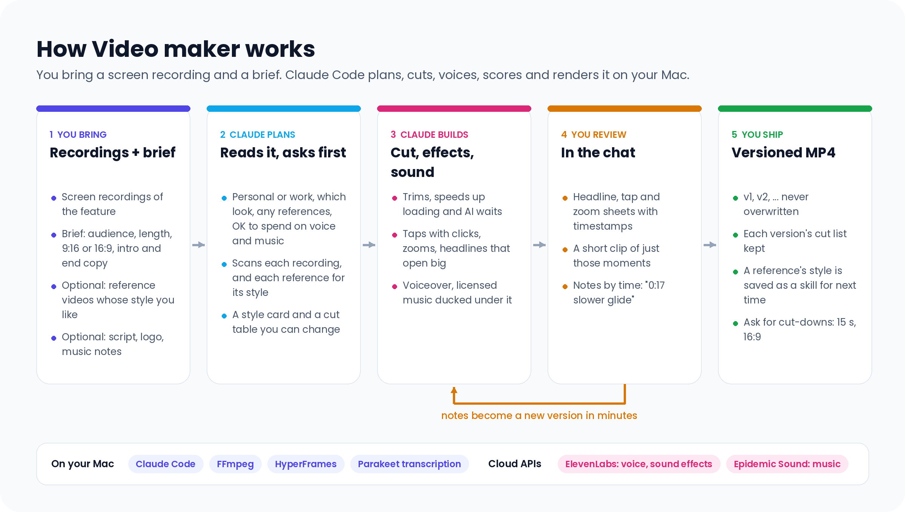
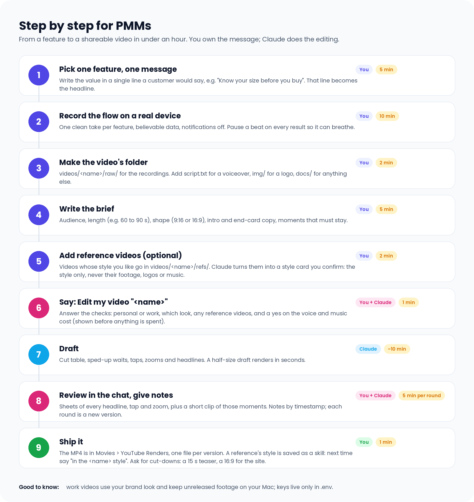
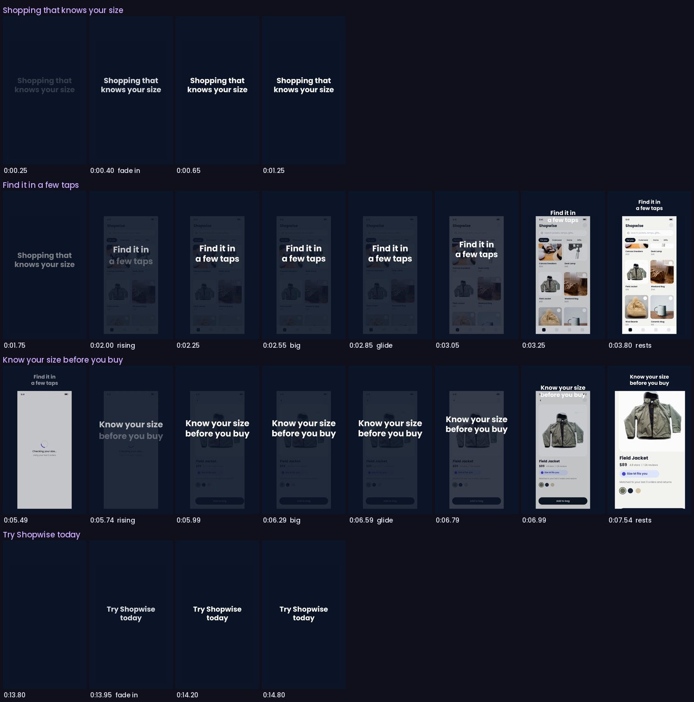
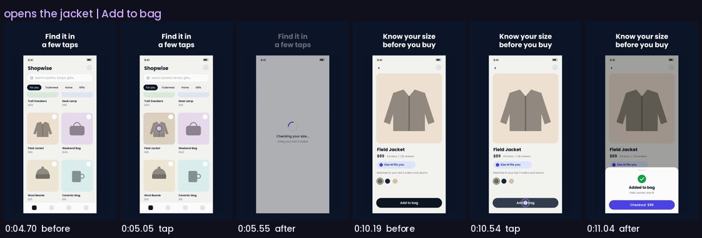
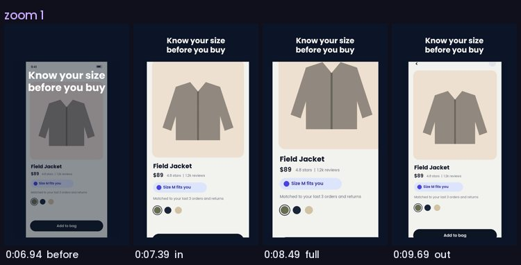

# Video maker for PMMs

[](LICENSE)
[](https://github.com/mahapatra-anjan-chai/video-maker/stargazers)


Turn a screen recording into a product video without opening an editor. Drop the recording in a folder, tell Claude
Code what the feature is for, and get back a cut with headlines, taps, zooms, a voiceover and licensed music, rendered
on your own Mac. Notes go in plain words ("at 0:17 make the glide slower") and each round is a new version.

<p align="center"></p>
<p align="center"><sub>Made by this repo from a 15-second recording of a made-up app (<code>docs/demo/make-demo.py</code>).</sub></p>

**If this saves you an afternoon, please ⭐ star the repo.** It helps other marketers find it.

## Try it first (2 minutes, no API keys)

Make the demo above yourself. You only need a Mac with Homebrew, FFmpeg and Pillow:

```bash
git clone https://github.com/mahapatra-anjan-chai/video-maker.git && cd video-maker
```

```bash
brew install ffmpeg pillow
```

```bash
python3 docs/demo/make-demo.py
```

It draws a 15-second recording of a made-up app, then cuts it the way it would cut yours: speeds up the loading
screen, adds the headline intros, the taps and the zoom, and renders a 1080x1920 MP4 to
`docs/demo/work/render/shopwise-demo.mp4`, with the review sheets in `docs/demo/work/review/`. The cut it follows is
[`docs/demo/cut.json`](docs/demo/cut.json): change a time or a headline and run it again. When you want it on your own
recordings, do the full [set up](#set-up).

## The workflow



## Step by step for PMMs



## What you get back

Every render comes with review sheets, so you can check the cut in the chat without scrubbing through a timeline.

**Headlines that open big, then make room for the product.** Each section starts with its one-line value full screen,
then the headline shrinks to the top while the recording plays.



**Taps where the user taps.** A ripple on the button just before the screen reacts, with a soft click in the mix.



**Zooms on the thing you are explaining.** The push happens inside the phone frame, so the headline stays still.



Also on every video:
- **Waits removed.** A motion scan finds loading spinners, AI "thinking" and pauses, and speeds them up 6 to 10x.
- **Voiceover** from your script in any ElevenLabs voice, one voice per speaker, timed to the sections.
- **Music** picked from Epidemic Sound for the video's length and pace, ducked under the voice, mixed to -14 LUFS.
- **Any shape.** 9:16 for Reels and Shorts, 16:9 for the site and YouTube, from the same recordings.
- **Your look.** Kit (glass cards, cyan), Brand (your company's palette, font and logo) or Mine.
- **Versions.** v1, v2, ... are never overwritten, and each version's cut list is kept, so any note can be undone.

For videos where the screens themselves must change (new copy inside the app, removed elements, animated diagrams
and scenes), the `youtube-edit` skill rebuilds them with HyperFrames.

## APIs and services

| Service | What it does here | How it connects | You need |
|---|---|---|---|
| **Claude Code** | Plans the edit, writes the cut list, runs every tool, sends you the review sheets | Runs in this folder; the skills live in `.claude/skills/` | A Claude plan with Claude Code |
| **ElevenLabs** | Voiceover from a script (one voice per speaker, word timings) and generated sound effects | REST API: `POST /v1/text-to-speech/{voice}/with-timestamps` and `POST /v1/sound-generation` (`elevenlabs.py`) | An API key with text to speech and sound effects; about 1 credit per character |
| **Epidemic Sound** | Searches and downloads licensed music and sound effects | The Epidemic Sound connector in Claude (MCP): `SearchRecordings`, `DownloadRecording`, `SearchSoundEffects`, `DownloadSoundEffect` | An Epidemic Sound account (optional; free sounds are used without it) |
| **HyperFrames** | Renders animated scenes and full rebuilds as HTML, frame by frame | Local CLI, `npx hyperframes` (the paid cloud render is never used) | Node 22+ and Chrome (installed by `setup.sh`) |
| **FFmpeg** | Cuts, speed changes, zooms, overlays, the sound mix and the final encode | Local CLI | `brew install ffmpeg` |
| **Parakeet** | Transcribes speech for cuts and captions, on your Mac | `npx hyperframes transcribe --engine parakeet` | Installed by `setup.sh` |

Nothing is spent without a yes: every ElevenLabs command prints its plan and estimated credits first and generates
nothing until you approve it.

### The commands Claude runs

| Command | Does |
|---|---|
| `fast-cut.py scan --video raw/rec.mov --out cut.json` | Finds the still stretches and writes a starter cut list |
| `fast-cut.py render --cut cut.json --out v1.mp4 [--draft]` | Renders the cut in one FFmpeg pass: segments, speed, box, zooms, taps, headline intros, texts |
| `fast-cut.py times --cut cut.json` | When each tap, zoom and headline lands in the output (used for the click sounds) |
| `review.py --cut cut.json --video v1.mp4 --out review/v1` | The review sheets and a clip of just the moments, for the chat |
| `contact-sheet.py --video raw/rec.mov --out sheet.png` | A labelled grid of frames to plan the cut from |
| `elevenlabs.py voiceover --script script.txt --out voiceover [--yes]` | Voiceover with word timings (plan and cost first) |
| `elevenlabs.py sfx --prompt "soft UI click" --out click.mp3 [--yes]` | A sound effect |
| `compose.py --spec storyboard.json --out public` | Builds a HyperFrames composition in the chosen look |
| `scenes.py anchor` / `scenes.py snap` | Places the moments you asked to animate and takes stills of the plan |

`fast-cut.py`, `review.py` and `contact-sheet.py` are in `.claude/skills/fast-cut/scripts/`; the rest are in
`.claude/skills/youtube-edit/scripts/`.

## Set up

You need a Mac with Homebrew, Google Chrome and Claude Code.

```bash
git clone https://github.com/mahapatra-anjan-chai/video-maker.git
```

```bash
cd video-maker && ./setup.sh
```

`setup.sh` checks Node 22+, FFmpeg, Python with numpy and Pillow, and auto-editor (it prints the `brew` command for
anything missing), installs HyperFrames and its Parakeet transcriber, fetches the free sound effects and GSAP, creates
`.env` from `.env.example`, and runs the tests. Put your ElevenLabs key in `.env`. For music, connect the Epidemic Sound
connector in Claude (optional).

**Make it yours:** fill in `.claude/skills/youtube-edit/styles/brand.json` with your company's colours, font and logo
(it ships with an example palette). Optionally add a `CLAUDE.local.md` (never committed) that names your company, its
brand rules, and any videos Claude must ask about before using as a reference.

## Make your first video

1. Make a folder and put your recordings in it: `videos/feature-launch/raw/`.
2. Optional: `videos/feature-launch/script.txt` for a voiceover, and a few lines of brief (audience, length, 9:16 or
   16:9, intro and end-card copy) in the chat or in `brief.json`.
3. Open Claude Code in this folder and say: `Edit my video "feature-launch"`.
4. Answer three questions (personal or work, which look, OK to spend on voice and music), review the draft in the
   chat, and give notes by timestamp.
5. The finished files are in `~/Movies/YouTube Renders/feature-launch/`, one per version.

## Keys and security

- **No keys are in this repo.** The ElevenLabs key lives only in `.env`, which is in `.gitignore`; `.env.example` is
  blank. The history has been scanned with gitleaks and is clean.
- Voice IDs in `elevenlabs.py` are public ElevenLabs library IDs, not secrets.
- Your footage, voiceovers, licensed music and renders stay in `videos/` and `~/Movies`, which are never committed.
  Keep unreleased product recordings out of anything you publish.
- If you fork this, turn on GitHub secret scanning and push protection, and never paste a key into a chat or a file
  outside `.env`.

## What's in the repo

| Folder | What it is |
|---|---|
| `.claude/skills/fast-cut/` | Fast edits of recordings: contact sheet, still-stretch scan, cut list, one-pass render, taps, zooms, headline intros, review sheets |
| `.claude/skills/youtube-edit/` | The full editing skill (from the WeAreNoCode kit): looks, HyperFrames compositions, ElevenLabs voiceover and sound effects |
| `docs/` | This README's images, and the scripts that make them (`make-visuals.py`, `demo/make-demo.py`) |
| `kit/` | The kit's style guide, prompts and licences |
| `videos/` | One folder per video (never committed); `_shared/sfx` holds reusable sounds |
| `setup.sh` | One-time setup after cloning |

`npm test` runs both skills' tests.

## Contributing

Ideas, bugs and new effects are welcome: open an issue with what you were making and what got in the way, or a pull
request with a test (`npm test` must end `OK`). Never attach footage you can't share publicly.

## Licence and credits

Video maker's own code and docs are under the [MIT licence](LICENSE). The full editing skill builds on the WeAreNoCode
YouTube Editor kit (`kit/README.md`), which keeps its own terms; [`NOTICE.md`](NOTICE.md) lists exactly what the
licence covers and what it doesn't. Fonts: DM Sans and Poppins (SIL Open Font License). Sound effects fetched by
`setup.sh` are from Pixabay (Pixabay Content License). Shopwise, the app in the demo, does not exist.
