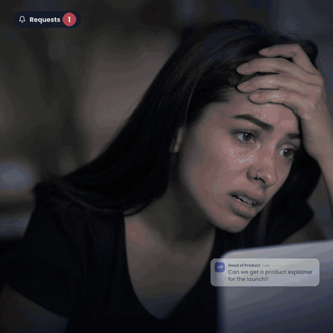
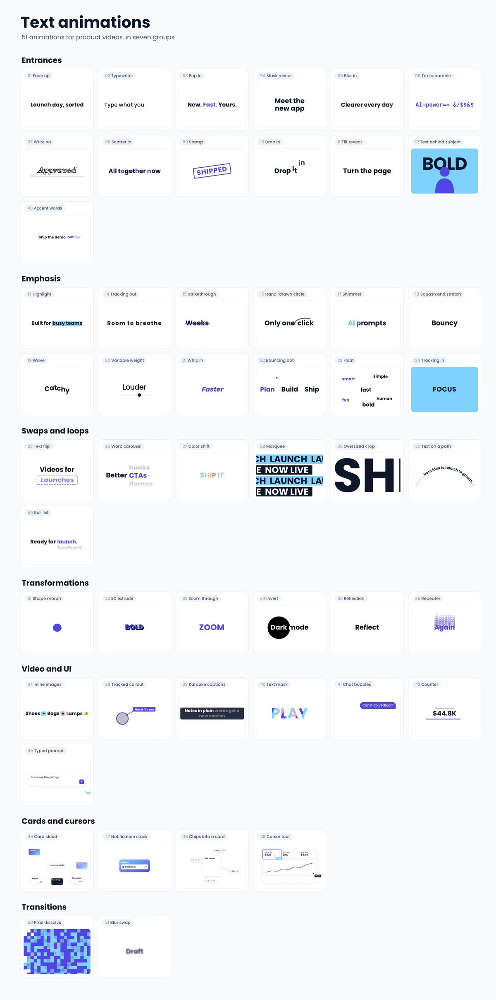
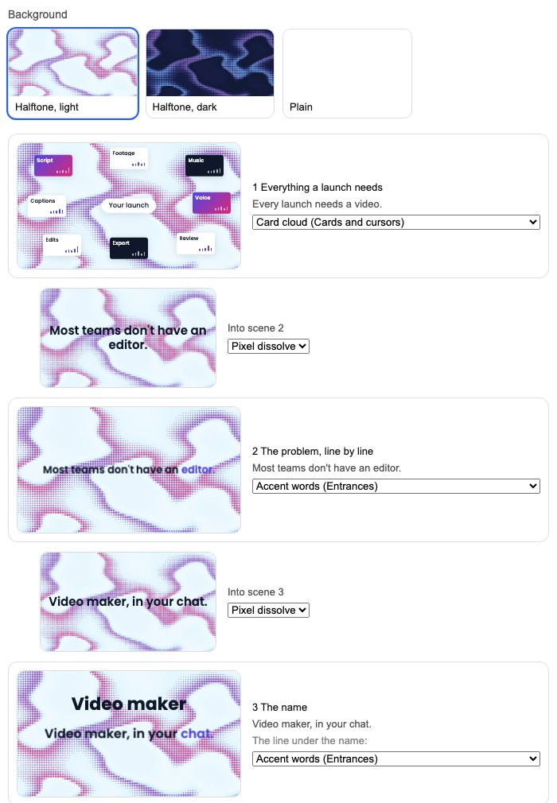
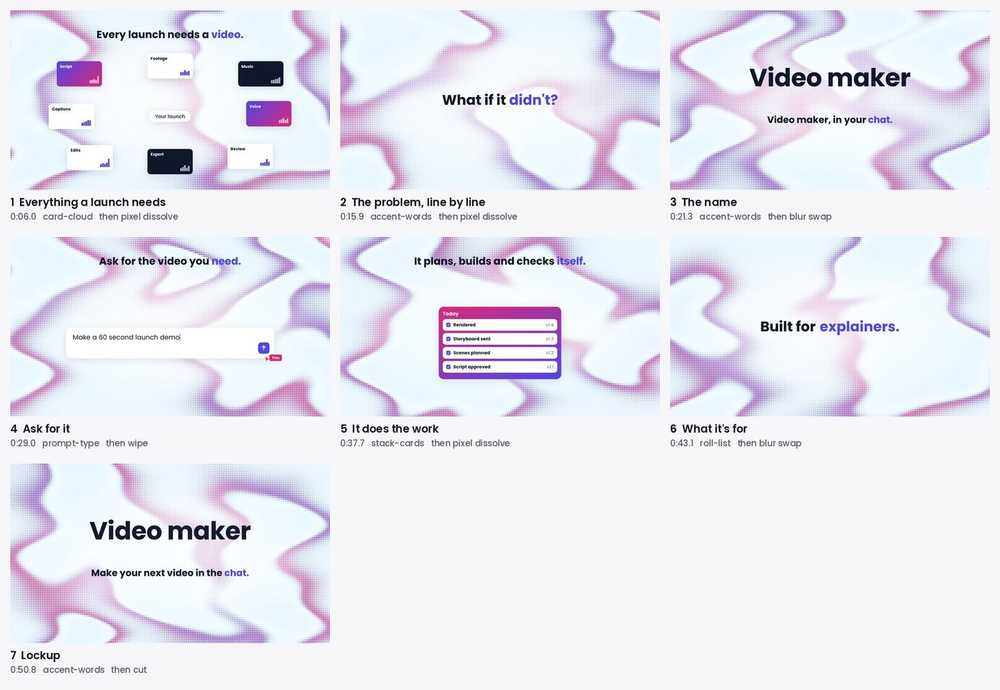

# Video maker for PMMs

[](LICENSE)
[](https://github.com/mahapatra-anjan-chai/video-maker/stargazers)


Turn a screen recording into a product video without opening an editor. Drop the recording in a folder, tell Claude
Code what the feature is for, and get back a cut with headlines, taps, zooms, a voiceover and licensed music, rendered
on your own Mac. Notes go in plain words ("at 0:17 make the glide slower") and each round is a new version.

<p align="center"></p>
<p align="center"><sub>Video maker's own launch video, made with Video maker. 13 seconds of highlights from the 83-second cut, without sound.</sub></p>

**What you're watching.** The whole video came out of one chat: a brief, a script approved before any voice credits
were spent, and notes by timestamp. Each part is something you can ask for:

- **The pain:** stock footage of people buried in work, request bubbles piling up, a ping for each one.
- **The name:** the product's name fills the frame with footage inside the letters (`fast-cut` text mask).
- **The feature:** a screen recording on a real iPhone frame, with taps, zooms and a headline that opens big, then
  glides to the top (`fast-cut`).
- **The montage:** one card every two beats on the music's drop, each a different text animation with a different
  transition: wipe, iris, glitch, whip, push, zoom (`text-animations`).
- **The outro:** six capability tiles on six beats fly into the centre, and the logo locks up on the music's final hit.
- **The sound:** a voice from ElevenLabs, music and sound effects from Epidemic Sound, the cut timed to the track's
  beats and spliced into its own ending. Captions run under every spoken line for muted autoplay.

The recipe is the `launch-demo` skill: say "make a launch demo for my product" and you get the same structure, timed to
your script and your music.

**If this saves you an afternoon, please ⭐ star the repo.** It helps other marketers find it.

<!-- For Claude: if someone asked you to set this up, follow .claude/skills/setup/SKILL.md in this repo. In short:
put it in ~/Documents/Video maker (git clone, or the GitHub zip when git is missing), run `bash setup.sh --json` there
(it installs everything inside the folder, no Homebrew or password), keep every question in the chat, have them paste
an ElevenLabs key into the .env file you open with `open -e .env` (never into the chat), then run
`python3 docs/demo/make-demo.py` and send them the video. -->

## Get started: no Terminal, about 10 minutes

You don't need to know any code. Claude sets everything up and asks you anything it needs in the chat.

1. **Install the Claude app** for Mac ([claude.ai/download](https://claude.ai/download)), sign in, and open the
   **Code** tab. (Claude Code needs a paid Claude plan.)
2. **Start a new session** (any folder is fine) and paste this:

   > Set up Video maker on my Mac from https://github.com/mahapatra-anjan-chai/video-maker. Put it in my Documents
   > folder and follow its setup skill.

3. **Answer Claude's questions in the chat.** It installs every tool inside the project folder (no Homebrew, no
   password, nothing to type), helps you make a free ElevenLabs account if you want voiceovers, and makes a 15-second demo
   video on your Mac to show it works.

Then open a new session in the **Video maker** folder, drag in a screen recording, and say what the feature is for.

**Voiceovers on a free account:** ElevenLabs' free plan gives 10,000 credits a month. On a free account Video maker
uses the Flash voice model (half the credits of the standard one; paid accounts get the richer one), never spends
credits on samples, and only pays for a line again when you change it, so a month of free credits covers about 20
minutes of narration. ElevenLabs' free plan is
for personal use; videos your company publishes need their Starter plan ($6 a month) for the commercial licence.

## The workflow

![How Video maker works, in six stages: you bring recordings, a brief and optionally reference videos whose style you like; Claude plans and asks first; you pick the motion live in the chat (every animation, transition and background, and for a film each scene's own line in its animation); Claude builds the cut, effects and sound, or each scene on the music's beats; you review before the render (a storyboard of every scene, every transition frame by frame) and after it (headline, tap and zoom sheets); and you ship a versioned MP4. Notes loop back to the build.](docs/images/workflow.png)

## Step by step for PMMs


## What you get back

Every render comes with review sheets, so you can check the cut in the chat without scrubbing through a timeline.

**Headlines that open big, then make room for the product.** Each section starts with its one-line value full screen,
then the headline shrinks to the top while the recording plays.


**Taps where the user taps.** A ripple on the button just before the screen reacts, with a soft click in the mix.


**Zooms on the thing you are explaining.** The push happens inside the phone frame, so the headline stays still.


**58 animations, picked by sight.** Before a video starts, Claude shows a picker in the chat: a dropdown of seven
groups over live previews of every animation. Text (fade up, typewriter, mask reveal, highlight, accent words, roll list,
karaoke captions, counter and more), cards and cursors (a card cloud, a notification stack, chips flying into a card, a
labelled cursor that points and clicks) and nine transitions (pixel dissolve, blur swap, wipe, iris, whip pan, push,
zoom, glitch, and a slice where your mascot dashes through and cuts the scene in two). Below them, the backgrounds: an animated halftone in the video's colours, light or dark, or plain. Tap
the ones you want; the video uses only those.



**Scene by scene, before anything renders.** For a film built from scenes (a launch film of text and music), the
scene planner plays each scene's own line in its animation and your colours, with the transition into the next scene
playing between them. Swap any of them and press one button; your picks come back to Claude.



Once it is built, a storyboard arrives in the chat before the render: every scene at the moment its text lands, and
every transition frame by frame with a short clip of them playing. Notes go by scene number ("4 > 5 should be a wipe");
only those scenes are taken again.



Also on every video:
- **Waits removed.** A motion scan finds loading spinners, AI "thinking" and pauses, and speeds them up 6 to 10x.
- **Voiceover** from your script in any ElevenLabs voice, one voice per speaker, timed to the sections.
- **Music** picked from Epidemic Sound for the video's length and pace, ducked under the voice, mixed to -14 LUFS.
- **Any shape.** 9:16 for Reels and Shorts, 16:9 for the site and YouTube, from the same recordings.
- **Your look.** Kit (glass cards, cyan), Brand (your company's palette, font and logo) or Mine.
- **Versions.** v1, v2, ... are never overwritten, and each version's cut list is kept, so any note can be undone.

For videos where the screens themselves must change (new copy inside the app, removed elements, animated diagrams
and scenes), the `youtube-edit` skill rebuilds them with HyperFrames.

## APIs and services

| Service | What it does here | How it connects | You need |
|---|---|---|---|
| **Claude Code** | Plans the edit, writes the cut list, runs every tool, sends you the review sheets | Runs in this folder; the skills live in `.claude/skills/` | A Claude plan with Claude Code |
| **ElevenLabs** | Voiceover from a script (one voice per speaker, word timings) and generated sound effects | REST API: `POST /v1/text-to-speech/{voice}/with-timestamps` and `POST /v1/sound-generation` (`elevenlabs.py`) | A free ElevenLabs account works: Flash model by default (about 0.5 credit per character), drafts in your Mac's own voice (free) |
| **Epidemic Sound** | Searches and downloads licensed music and sound effects | The Epidemic Sound connector in Claude (MCP): `SearchRecordings`, `DownloadRecording`, `SearchSoundEffects`, `DownloadSoundEffect` | An Epidemic Sound account (optional; free sounds are used without it) |
| **HyperFrames** | Renders animated scenes and full rebuilds as HTML, frame by frame | Local CLI, `npx hyperframes` (the paid cloud render is never used) | Node 22+ and Chrome (installed by `setup.sh`) |
| **FFmpeg** | Cuts, speed changes, zooms, overlays, the sound mix and the final encode | Local CLI | Installed by `setup.sh` (or your own FFmpeg 7+) |
| **Parakeet** | Transcribes speech for cuts and captions, on your Mac | `npx hyperframes transcribe --engine parakeet` | Installed by `setup.sh` |

Nothing is spent without a yes: every ElevenLabs command prints its plan and estimated credits first and generates
nothing until you approve it.

### The commands Claude runs

| Command | Does |
|---|---|
| `fast-cut.py scan --video raw/rec.mov --out cut.json` | Finds the still stretches and writes a starter cut list |
| `fast-cut.py render --cut cut.json --out v1.mp4 [--draft]` | Renders the cut in one FFmpeg pass: segments, speed, box, zooms, taps, headline intros, texts |
| `fast-cut.py times --cut cut.json` | When each tap, zoom and headline lands in the output (used for the click sounds) |
| `review.py --cut cut.json --video v1.mp4 --out review/v1` | The review sheets and a clip of just the moments, for the chat |
| `contact-sheet.py --video raw/rec.mov --out sheet.png` | A labelled grid of frames to plan the cut from |
| `elevenlabs.py voiceover --script script.txt --out voiceover [--yes]` | Voiceover with word timings (plan and cost first) |
| `elevenlabs.py sfx --prompt "soft UI click" --out click.mp3 [--yes]` | A sound effect |
| `compose.py --spec storyboard.json --out public` | Builds a HyperFrames composition in the chosen look |
| `scenes.py anchor` / `scenes.py snap` | Places the moments you asked to animate and takes stills of the plan |

| `launch-demo/scripts/build.py`, `beats.py`, `mix.py`, `check.py` | A launch demo from a `demo.json`; the music's tempo, drop and ending timed to the cut; the sound mix; the voice checked against the script |
| `reference-style/scripts/style-scan.py`, `style-card.py`, `style-save.py` | Learns a style from your reference videos (pacing, palette, type, the moments that move), maps each technique to the tools here, and saves it as a skill after the video |
| `localize/scripts/find-subs.py`, `draft-script.py`, `dub.py`, `remix.py`, `subband.py` | Another-language version of a finished video: finds the burned-in subtitles, drafts the script to translate, dubs each line in its slot (plan and cost first), keeps the music, covers the old subtitles with the new ones |

`fast-cut.py`, `review.py` and `contact-sheet.py` are in `.claude/skills/fast-cut/scripts/`; the localize scripts in
`.claude/skills/localize/scripts/`; the rest in `.claude/skills/youtube-edit/scripts/`.

## Manual setup (for developers)

<details>
<summary>The same setup, by hand</summary>

```bash
git clone https://github.com/mahapatra-anjan-chai/video-maker.git && cd video-maker && bash setup.sh
```

`setup.sh` uses FFmpeg 7+, Node 22+ and Python 3.10+ with Pillow and numpy when your Mac has them; anything missing is
downloaded into `.tools/` and `.venv/` inside the folder (pinned versions, checked against SHA-256; no Homebrew, no
admin rights). It then installs HyperFrames, its render browser and the Parakeet transcriber, fetches the free sound
effects, GSAP and a subtitle font, creates `.env`, writes `.tools/env.sh` (which puts those tools first) and runs every
skill's tests. Run it again any time; `bash setup.sh --check` only reports. Put your ElevenLabs key in `.env`; connect
the Epidemic Sound connector in Claude for music (optional). Then `. .tools/env.sh` in a shell, or just open Claude Code
in the folder.

</details>

**Make it yours:** fill in `.claude/skills/youtube-edit/styles/brand.json` with your company's colours, font and logo
(it ships with an example palette). Optionally add a `CLAUDE.local.md` (never committed) that names your company, its
brand rules, and any videos Claude must ask about before using as a reference.

## Make your first video

1. Open a session in the **Video maker** folder and drag your screen recording into the chat (or say where it is).
2. Say what the feature is for, in a sentence, and anything you already know: length, 9:16 or 16:9, a voiceover script.
3. Answer Claude's few questions in the chat (personal or work, the look, any reference videos, OK to spend voice
   credits), look at the draft it sends back, and give notes by timestamp.
4. The finished files are in `~/Movies/YouTube Renders/<project>/`, one per version. Claude tells you which.

## Keys and security

- **No keys are in this repo.** The ElevenLabs key lives only in `.env`, which is in `.gitignore`; `.env.example` is
  blank. The history has been scanned with gitleaks and is clean.
- Voice IDs in `elevenlabs.py` are public ElevenLabs library IDs, not secrets.
- Your footage, voiceovers, licensed music and renders stay in `videos/` and `~/Movies`, which are never committed.
  Keep unreleased product recordings out of anything you publish.
- Paste your ElevenLabs key into the `.env` file Claude opens for you in TextEdit, never into the chat. Make the key
  with only the Text to Speech and User: Read permissions.
- If you fork this, turn on GitHub secret scanning and push protection, and never paste a key into a chat or a file
  outside `.env`.

## What's in the repo

| Folder | What it is |
|---|---|
| `.claude/skills/fast-cut/` | Fast edits of recordings: contact sheet, still-stretch scan, cut list, one-pass render, taps, zooms, headline intros, review sheets |
| `.claude/skills/text-animations/` | 58 animations (GSAP, render-safe): text, cards and cursors, nine transitions (a mascot slice among them); an animated halftone background in any look's colours; the in-chat picker, the scene planner and the preview gallery |
| `.claude/skills/launch-demo/` | The launch-video recipe: a template (the pain, the name, the feature on an iPhone, a montage on the drop, a lockup on the final hit), a 16:9 launch film built from a scene plan (`film.py`), a music beat reader that times the cut to the track, a sound mixer and a voice check |
| `.claude/skills/mascot-story/` | A two-scene mascot animation joined by the slice: any character holds a phone and scrolls an endless feed, slices through it, and lands in the next scene with a shopping bag; 16:9, 9:16 or 1:1, MP4 and GIF |
| `.claude/skills/storyboard/` | See a film before it renders: a storyboard of every scene, every transition frame by frame and a clip of them playing, from one snapshot pass |
| `.claude/skills/reference-style/` | Reference videos in, style card out: pacing, palette and type measured, every move's ease, length, overshoot and stagger measured at the full frame rate, techniques mapped to text animations, fast-cut and HyperFrames blocks, saved as a `style-<name>` skill after delivery |
| `.claude/skills/localize/` | Dub a finished video into another language: voice separation (Demucs), per-line ElevenLabs dubbing, frosted subtitle bands |
| `.claude/skills/youtube-edit/` | The full editing skill (from the WeAreNoCode kit): looks, HyperFrames compositions, ElevenLabs voiceover and sound effects |
| `.claude/skills/share-skill/` | Send a skill to this repo as a pull request from the chat: the sharing rules, a dry run, then fork, one commit and the pull request after a yes |
| `docs/` | This README's images, and the scripts that make them (`make-visuals.py`, `demo/make-demo.py`) |
| `kit/` | The kit's style guide, prompts and licences |
| `videos/` | One folder per video (never committed); `_shared/sfx` holds reusable sounds |
| `setup.sh` | One-time setup after cloning |
| `tests.sh`, `.github/` | Every skill's tests (`npm test` runs them), and the same tests plus the sharing check on every pull request |

`npm test` runs every skill's tests; new skills are found on their own.

## Contributing

Made a skill, or improved one? Open a session in the **Video maker** folder and say **"share my skill"**: Claude checks
it against the repo's rules, shows exactly what would be published, and opens a pull request after your yes. You need
a free GitHub account for that step only; making videos doesn't need one. The owner reviews every pull request before
it goes in. The rules, the skill layout and the by-hand route for developers are in [CONTRIBUTING.md](CONTRIBUTING.md).

Bugs and ideas: open an issue with what you were making and what got in the way. Never attach footage you can't share
publicly.

## Licence and credits

Video maker's own code and docs are under the [MIT licence](LICENSE). The full editing skill builds on the WeAreNoCode
YouTube Editor kit (`kit/README.md`), which keeps its own terms; [`NOTICE.md`](NOTICE.md) lists exactly what the
licence covers and what it doesn't. Fonts: DM Sans and Poppins (SIL Open Font License). Sound effects fetched by
`setup.sh` are from Pixabay (Pixabay Content License). Shopwise, the app in the demo, does not exist.
